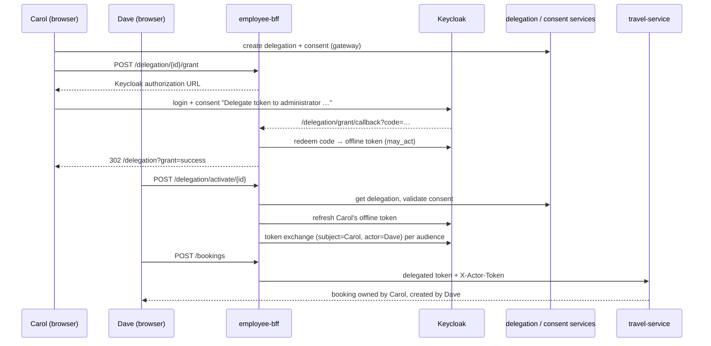

# Delegate Journey: Dave Acts on Carol's Behalf

## Overview

**Personas:** Carol (`carol.executive`, delegator) lets Dave (`dave.assistant`, delegate) book travel and file expenses for her. Both are in tenant `tenant-a` (Keycloak group `TenantA`).

**Covers:** Carol creates the delegation and consent → Carol authorizes it in Keycloak → Dave activates delegation mode → Dave's BFF calls create records owned by Carol → audit → exit and revocation.

**Model (ADR-024):** Keycloak issues RFC 8693 delegated tokens with `sub` = Carol and `act.sub` = Dave. Carol's identity is in a Keycloak-signed token, never in a header. Dave acts with **his own** roles; delegation never grants Carol's. delegation-service and consent-service remain the business rules (who, purpose, scopes, validity window).

> Keycloak delegation (`token-exchange-delegation`, `parameterized-scopes`) is a **preview** feature in Keycloak 26.8 and may change in later 26.x releases.

| Component | Port | Role |
|---|---|---|
| Next.js | 3000 | Delegation page, grant modal, delegation banner |
| employee-bff | 8085 | Grant ceremony, encrypted offline-token store, delegated exchange, delegation context in session, delegated downstream calls |
| Keycloak | 8080 | Consent screen, `may_act`, delegated token exchange, FGAP v2 tenant boundary |
| delegation-service | 8083 | Delegation records (PostgreSQL + Neo4j) |
| consent-service | 8084 | Consent records; validation at activation |
| travel-service / expense-service | 8081 / 8082 | Verify the actor, ask OPA, write records and audit |
| OPA | 8181 | `has_active_delegation` + consent scope rules |
| PostgreSQL schema `bff` | 5432 | `delegation_grant` table |

## Prerequisites

- Stack running. Compose enables the Keycloak features; `keycloak-config` applies the realm; `keycloak-fgap` applies the FGAP permissions.
- Carol and Dave are in the same tenant group. FGAP v2 lets members of a tenant group delegate to each other; for a cross-tenant pair Keycloak silently drops the delegation scope.
- `BFF_GRANT_ENCRYPTION_KEY` set (the committed value is a demo key).
- Automated check of the whole flow: `scripts/end-to-end-test/run-delegation-flow.sh`.

---

## Flow



---

## 1. Carol Creates the Delegation and Consent

UI: `/delegation` → "Grant delegation" (`GrantDelegationModal`). Both calls go through the gateway with Carol's token.

```
POST /api/delegations   { "delegateId": "dave.assistant", "purpose": "book_travel",
                          "scopes": ["view_bookings", "create_bookings"], "expiresAt": "2027-01-01T00:00:00" }
POST /api/consents      { "grantorId": "carol.executive", "granteeId": "dave.assistant",
                          "delegationId": "<id>", "purpose": "book_travel",
                          "scopes": ["view_bookings", "create_bookings"], "expiresAt": "…" }
```

- delegation-service sets `delegatorId` from the token (OPA `create_delegation`: delegator is the caller).
- If consent creation fails (other than "already exists") the modal revokes the delegation again.
- The modal then starts step 2 automatically.

## 2. Carol Authorizes the Delegation in Keycloak

**Start.** `startDelegationGrant(id)` → `POST /api/bff/delegation/{id}/grant`. The BFF loads the delegation, requires the caller to be its delegator (403) and the delegation to be active (400), stores `state` and a PKCE verifier in Carol's BFF session, and returns `{ "authorizationUrl": … }`:

```
http://localhost:8080/realms/corporate-travel/protocol/openid-connect/auth
  ?client_id=delegation-grant&response_type=code
  &scope=openid offline_access delegation:user:dave.assistant
  &redirect_uri=http://localhost:3000/api/bff/delegation/grant/callback
  &state=…&code_challenge=…&code_challenge_method=S256&login_hint=carol.executive
```

**Keycloak.** Carol signs in (normally SSO) and sees the consent screen "Delegate token to administrator …" (Keycloak's built-in text). `delegation-grant` is a dedicated confidential client with consent required, so normal portal logins never show this screen.

**Callback.** Keycloak redirects to `/api/bff/delegation/grant/callback`; Next.js rewrites it to the BFF, carrying Carol's `JSESSIONID`. The BFF:

1. Matches `state` to the pending grant.
2. Redeems the code (with the PKCE verifier) for an access token and an offline refresh token.
3. Requires `preferred_username` = delegator, a `may_act` claim (absent if FGAP denied the pair) and a refresh token. Otherwise it revokes the token and reports an error.
4. Stores the offline token in `bff.delegation_grant`, AES-256-GCM encrypted with the delegation id as AAD.
5. Redirects to `/delegation?grant=success&delegationId=…`, or `?grant=error&reason=…`:

| `reason` | Meaning |
|---|---|
| `access_denied` | Carol declined the consent screen |
| `delegation_not_permitted` | No `may_act`: delegate not in Carol's tenant group |
| `wrong_account` | Signed in as someone other than the delegator |
| `unknown_or_expired_request` | `state` not in this BFF session |
| `code_redemption_failed`, `no_code` | Keycloak did not return a usable code |

`GrantResultBanner` shows the outcome. In "Delegations I granted", the **Keycloak** column shows *Authorized* (from `GET /api/bff/delegation/{id}/grant`) or an **Authorize** button that restarts this step.

The offline session survives Carol's logout and expires after 30 days idle (realm default); after that Carol must authorize again.

## 3. Dave Finds the Delegation

`/delegation` → "Delegations to me" → `getDelegationsToMe()` → gateway `GET /api/delegations/to-me`. The UI derives `ACTIVE` / `REVOKED` / `EXPIRED` from `active`, `valid` and `revokedAt`.

## 4. Dave Activates Delegation Mode

"Activate" → `activateDelegation(id)` → `POST /api/bff/delegation/activate/{id}` (no body).

`TokenExchangeService.exchangeForDelegation`:

1. `GET /api/delegations/{id}` (delegation-service, Dave's token) → `delegatorId` = `carol.executive`.
2. Caller must be the delegate — else 403.
3. `POST /api/consents/validate` `{ grantorId, granteeId, purpose, scopes }` → `consentId`. Invalid or unreachable → 502 `Consent validation failed: …`.
4. Carol's access token from the stored grant: decrypt, refresh at Keycloak (`may_act` is preserved).
   - No grant → 409 (not authorized yet).
   - Delegation no longer active → grant revoked and deleted → 400.
   - Keycloak rejects the refresh (offline session gone) → grant deleted → 409.
5. For each audience in `delegation.audiences` (`travel-service`, `expense-service`), an RFC 8693 exchange by the `employee-bff` client:

```
grant_type=urn:ietf:params:oauth:grant-type:token-exchange
subject_token=<Carol's access token, with may_act>   subject_token_type=…:access_token
actor_token=<Dave's access token>                    actor_token_type=…:access_token
audience=travel-service
```

   Result: `sub` = Carol, `act: { "sub": "<Dave's UUID>" }`, `aud` = one service, 300 s, no refresh token.
6. A `DelegationContext` is stored in Dave's BFF session (`ACTIVE_DELEGATION_CONTEXT`). It expires with the earliest token (about 5 minutes); Dave then activates again.

Response — tokens are never returned to the browser:

```json
{ "delegationId": "<id>", "actorId": "dave.assistant", "subjectId": "carol.executive",
  "audiences": ["travel-service", "expense-service"], "purpose": "book_travel",
  "consentId": "<consent-id>", "expiresAt": "2026-10-08T10:05:00Z" }
```

The frontend then reads `GET /api/bff/delegation/context` and shows the `DelegationBanner`.

## 5. Dave Creates a Booking for Carol

Same UI and call as for himself: `POST /api/bff/bookings`. Only BFF routes (`/api/bff/bookings`, `/api/bff/expenses`, `/api/bff/dashboard`) use delegation mode; gateway calls from the browser stay Dave's own.

**BFF → travel-service headers** (`DelegationRequestHeaders`):

| Header | Value |
|---|---|
| `Authorization` | delegated token for `travel-service` |
| `X-Actor-Token` | Dave's own access token |
| `X-Delegation-Id` | delegation id |
| `X-Consent-Id` | consent id |
| `X-Delegation-Purpose` | `book_travel` |

**travel-service:**

1. JWT validation (`aud` = `travel-service`).
2. `DelegatedActorFilter`: the token has `act`, so `X-Actor-Token` must verify, have `sub == act.sub`, the same `tenant_id`, and no `act` of its own. Else 401 `invalid_delegation`.
3. `SecurityContext`: `userId` = `actorId` = `dave.assistant` with Dave's roles; `subjectId` = `carol.executive`; delegation and consent ids from the headers.
4. OPA:

```json
{ "user": { "user_id": "dave.assistant", "tenant_id": "tenant-a", "roles": ["employee", "assistant", "..."] },
  "action": "create_booking",
  "resource": { "type": "booking", "tenant_id": "tenant-a", "user_id": "carol.executive" },
  "delegation": { "active": true, "delegate_id": "dave.assistant", "delegator_id": "carol.executive" },
  "consent": { "valid": true, "consent_id": "<consent-id>",
               "scopes": ["book_travel", "view_booking", "create_expenses", "submit_expenses"] } }
```

   `consent.scopes` comes from the purpose (`OpaClient.extractScopesFromPurpose`), not from the delegation's `scopes` list.
5. Write: `user_id` = `carol.executive`, `created_by` = `dave.assistant`; audit `CREATE` with `actor_id` Dave, `subject_id` Carol, `delegation_id`, `consent_id`.

Listing (`GET /api/bff/bookings`) in delegation mode returns Carol's bookings via `view_booking` + `has_active_delegation`.

## 6. Dave Files and Submits an Expense for Carol

`POST /api/bff/expenses`, then `POST /api/bff/expenses/{id}/submit`. The BFF uses the `expense-service` delegated token with the same headers. Submit needs `has_active_delegation`, a valid consent with `create_expenses` (granted by purpose `book_travel`) and `DRAFT` status; the budget check applies as usual. Audit rows carry both identities.

## 7. Audit Trail

```bash
curl -s -b dave.txt -H "Authorization: Bearer $DAVE" \
  http://localhost:8085/api/bff/bookings/$BOOKING_ID/audit | jq '.[0]'
# { "action": "CREATE", "actorId": "dave.assistant", "subjectId": "carol.executive",
#   "delegationId": "<id>", "consentId": "<consent-id>", "tenantId": "tenant-a", ... }
```

## 8. Dave Exits Delegation Mode

Banner "Exit" → `DELETE /api/bff/delegation/deactivate` → the session attribute is removed → 204. Nothing is written elsewhere; the delegation and Carol's grant stay valid for the next activation.

## 9. Carol Revokes the Delegation

"Revoke" on `/delegation` → `revokeDelegationAndGrant(id)` → `DELETE /api/bff/delegation/{id}`:

1. delegation-service revoke (delegator only; others get 403).
2. RFC 7009 revocation of the offline token, which ends Carol's Keycloak offline session for it.
3. The `delegation_grant` row is deleted. → 204.

After this, activation returns 409. Delegated tokens already in an active session stay valid until they expire (at most 300 s).

---

## Keycloak Configuration (realm-as-code)

| Item | Where |
|---|---|
| `KC_FEATURES=token-exchange-delegation,parameterized-scopes` | `docker-compose.yml` (`keycloak`) |
| `adminPermissionsEnabled: true` (FGAP v2) | `infrastructure/keycloak/config/corporate-travel.json` |
| `delegation:user` client scope with a `may_act` mapper (declared explicitly; Keycloak only auto-creates it for new realms) | same file |
| `delegation-grant` client: confidential, consent required, PKCE S256, optional scopes `offline_access` + `delegation:user`, `employee-bff` audience, redirect `http://localhost:3000/api/bff/delegation/grant/callback` | same file |
| `employee-bff`: `standard.token.exchange.enabled=true` (only client with it) | same file |
| FGAP: per tenant group, a group policy plus a `delegate-members` permission on the Groups resource type | `infrastructure/keycloak/fgap/apply-delegation-permissions.sh`, run by the `keycloak-fgap` compose step (config-cli cannot manage `admin-permissions`) |
| BFF settings: `delegation.grant.*` (client, redirect, return URL, encryption key), `delegation.audiences` | `services/employee-bff/src/main/resources/application.yml` |

`scripts/keycloak-realm-test/validate-realm-config.sh` covers grant → `may_act` → offline token, delegated exchange, revocation and cross-tenant denial.

---

## Error Scenarios

| Scenario | Status | Body / effect |
|---|---|---|
| Grant started by someone other than the delegator | 403 | `Only the delegator can authorize delegation …` |
| Grant started for an inactive delegation | 400 | `Delegation … is not active` |
| Activation by someone other than the delegate | 403 | `Only the delegate can activate delegation …` |
| Delegator has not authorized (or grant removed) | 409 | `Delegation not authorized` |
| Delegation revoked or expired at activation | 400 | grant revoked and deleted |
| Delegation not found | 404 | |
| Consent invalid or consent-service unreachable | 502 | `Consent validation failed: …` / `Consent service unreachable: …` |
| Keycloak rejects the delegated exchange | 502 | `Token exchange failed` |
| Delegated token with missing or mismatching `X-Actor-Token` | 401 | `invalid_delegation` (from the service) |
| OPA deny (e.g. purpose lacks the required scope) | 403 | passed through by the BFF |
| Revoke by someone other than the delegator | 403 | passed through from delegation-service |
| Delegation context expired | — | BFF calls revert to Dave's own identity; activate again |

**Troubleshooting**

- `grant=error&reason=delegation_not_permitted`: check both users are in the same tenant group and that `keycloak-fgap` completed.
- 409 on activation right after granting: check `GET /api/bff/delegation/{id}/grant` returns `authorized: true`; the callback must reach the BFF through `localhost:3000` with the same `JSESSIONID`.
- Booking owned by Dave instead of Carol: delegation mode was not active in this BFF session (expired or a different cookie jar), or the call went through the gateway instead of the BFF.

---

## curl Sequence

The consent screen needs a browser; `scripts/lib/delegation-grant.sh` drives it with curl.

```bash
token() { curl -s http://localhost:8080/realms/corporate-travel/protocol/openid-connect/token \
  -d grant_type=password -d client_id=employee-bff -d client_secret=bff-service-secret-change-in-production \
  -d username="$1" -d password=password123 | jq -r .access_token; }
CAROL=$(token carol.executive); DAVE=$(token dave.assistant)
GW=http://localhost:8000; BFF=http://localhost:8085

# 1. Carol: delegation + consent
DELEGATION_ID=$(curl -s -X POST $GW/api/delegations -H "Authorization: Bearer $CAROL" -H "Content-Type: application/json" \
  -d '{"delegateId":"dave.assistant","purpose":"book_travel","scopes":["view_bookings","create_bookings"],"expiresAt":"2027-01-01T00:00:00"}' | jq -r .id)
curl -s -X POST $GW/api/consents -H "Authorization: Bearer $CAROL" -H "Content-Type: application/json" \
  -d "{\"grantorId\":\"carol.executive\",\"granteeId\":\"dave.assistant\",\"delegationId\":\"$DELEGATION_ID\",\"purpose\":\"book_travel\",\"scopes\":[\"view_bookings\",\"create_bookings\"]}" | jq .id

# 2. Carol: Keycloak grant (login + consent screen, scripted)
source scripts/lib/delegation-grant.sh
bff_authorize_delegation $BFF carol.executive password123 "$CAROL" "$DELEGATION_ID"   # …/delegation?grant=success…

# 3. Dave: activate (keep the session cookie)
curl -s -c dave.txt -b dave.txt -X POST $BFF/api/bff/delegation/activate/$DELEGATION_ID \
  -H "Authorization: Bearer $DAVE" | jq '{actorId, subjectId, audiences, expiresAt}'

# 4. Dave: booking for Carol
BOOKING_ID=$(curl -s -c dave.txt -b dave.txt -X POST $BFF/api/bff/bookings \
  -H "Authorization: Bearer $DAVE" -H "Content-Type: application/json" \
  -d '{"destination":"London","startDate":"2026-12-01","endDate":"2026-12-05","budget":80000,"budgetCurrency":"INR","tenantId":"x","userId":"x","status":"PENDING"}' \
  | tee /dev/stderr | jq -r .id)                                                          # userId carol.executive, createdBy dave.assistant

# 5. Audit
curl -s -b dave.txt -H "Authorization: Bearer $DAVE" $BFF/api/bff/bookings/$BOOKING_ID/audit | jq '.[0] | {actorId, subjectId, delegationId, consentId}'

# 6. Dave exits; Carol revokes
curl -s -b dave.txt -X DELETE $BFF/api/bff/delegation/deactivate -H "Authorization: Bearer $DAVE" -o /dev/null -w '%{http_code}\n'   # 204
curl -s -X DELETE $BFF/api/bff/delegation/$DELEGATION_ID -H "Authorization: Bearer $CAROL" -o /dev/null -w '%{http_code}\n'         # 204
curl -s -b dave.txt -X POST $BFF/api/bff/delegation/activate/$DELEGATION_ID -H "Authorization: Bearer $DAVE" -o /dev/null -w '%{http_code}\n'  # 409
```

---

## Related

- [ADR-024: Keycloak native RFC 8693 delegation](../../architecture-decision-records/ADR-024:%20Adopt%20Keycloak%20Native%20RFC%208693%20Delegation.md) — decision, spike results, design choices
- [ADR-004: Token exchange for delegated identity](../../architecture-decision-records/ADR-004:%20Adopt%20OAuth%202.0%20Token%20Exchange%20for%20Delegated%20Identity.md)
- [ADR-005: Consent and purpose binding](../../architecture-decision-records/ADR-005:%20Implement%20External%20Consent%20and%20Purpose%20Binding%20Service.md)
- [ADR-011: Audit and compliance ledger](../../architecture-decision-records/ADR-011:%20Implement%20Comprehensive%20Audit%20and%20Compliance%20Ledger.md)
- [ADR-018: BFF strategy](../../architecture-decision-records/ADR-018:%20Backend-for-Frontend%20(BFF)%20Strategy.md)
- [`AUTH-AND-SESSION.md`](../AUTH-AND-SESSION.md), [`AUTHORIZATION-GUIDE.md`](../AUTHORIZATION-GUIDE.md)
